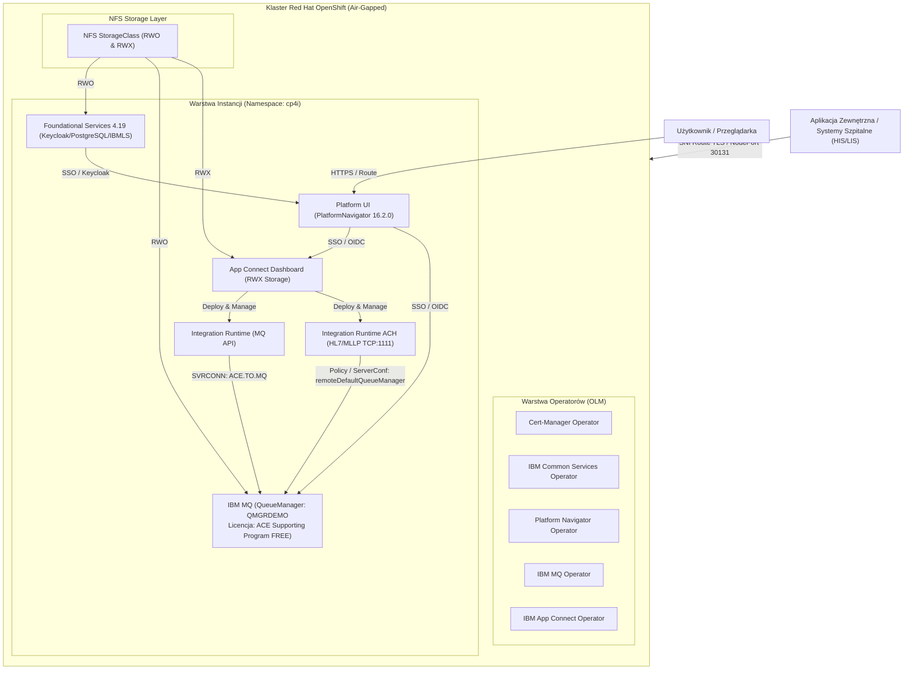

# Architektura Rozwiązania: CP4I na Red Hat OpenShift z NFS w środowisku Air-Gapped

Niniejszy dokument opisuje architekturę logiczną, zależności operatorów, specyfikę konfiguracji pamięci masowej NFS oraz model wdrażania IBM Cloud Pak for Integration (CP4I 16.2.0 LTS) w odizolowanym środowisku sieciowym (air-gapped).

---

## 1. Zakres Komponentów

1. **Wymagania klastrowe i bezpieczeństwo (Foundations & Cert-Manager)**
   - **Red Hat OpenShift Cert-Manager Operator**: Automatyczne generowanie i rotacja certyfikatów TLS dla komunikacji międzykomponentowej (MQ PKI, Route passthrough SNI).
   - **IBM Cloud Pak Foundational Services (Common Services v4.19 LTS)**: Zarządzanie tożsamością (Keycloak + PostgreSQL), kontrola dostępu (RBAC), wspólne usługi autoryzacji oraz licencjonowanie (IBM License Service).
2. **Platform UI (Platform Navigator)**
   - Główna konsola zarządzająca i punkt integracji (Single Pane of Glass) dla wszystkich możliwości CP4I (wersja 16.2.0).
   - Integruje uwierzytelnianie SSO (Keycloak) z instancjami MQ i App Connect.
3. **Enterprise Messaging (IBM MQ — Licencjonowany w ramach ACE)**
   - Podstawowa instancja `QueueManager` (SingleInstance, wersja 10.0.0.5-r2) z trwałym wolumenem opartym na NFS (RWO).
   - Zabezpieczenie kanałów TLS (`ACE.TO.MQ`, `EXTAPP.TO.MQ`), konfiguracja obiektów MQSC (CHLAUTH, CONNAUTH) i parametrów `qm.ini`.
   - **Licencjonowanie jako Supporting Program dla ACE**: Zgodnie z [dokumentacją IBM MQ License Service Customization](https://www.ibm.com/docs/en/ibm-mq/10.0.x?topic=examples-example-customizing-license-service-annotations), instancja MQ zawiera adnotację `spec.annotations.productMetric: FREE`, co informuje IBM License Service o rozliczaniu instancji w ramach puli licencyjnej IBM App Connect Enterprise (brak podwójnego naliczania VPC).
4. **App Connect Enterprise (ACE) & App Connect for Healthcare (ACH)**
   - **App Connect Dashboard**: Narzędzie operacyjne i Content Server przechowujący pliki integracji (BAR), wymagający pamięci masowej w trybie współdzielonym **ReadWriteMany (RWX)** zapewnianym przez NFS.
   - **Integration Runtime**: Lekkie kontenery uruchomieniowe przepływów integracyjnych (stateless / stateful, wersja 13.0.3.0-r1).
   - **ACH (App Connect for Healthcare)**: Dedykowana instancja Integration Runtime skonfigurowana do obsługi protokołu MLLP/HL7 (port TCP 1111) zintegrowana z kolejkami `HL7.*` w menedżerze `QMGRDEMO` za pośrednictwem konfiguracji `policyproject` i `serverconf`.

---

## 2. Diagram Architektury Przepływu



---

## 3. Specyfika Środowiska Air-Gapped (Bez dostępu do Internetu)

W środowisku odciętym od Internetu:
1. **Lokalny Rejestr Obrazów**: Wszystkie obrazy kontenerowe (dla operatorów oraz instancji runtime) zostały uprzednio zmirrorowane do lokalnego rejestru OCP (np. wewnętrzny rejestr OpenShift, Harbor, Quay) za pomocą `oc-mirror` lub `oc-ibm_pak`.
2. **CatalogSource**: Zamiast pobierać katalogi z publicznych rejestrów, subskrypcje operatorów odwołują się do lokalnego zasobu `ibm-operator-catalog` (z digestami sha256) zarejestrowanego w przestrzeni `openshift-marketplace`.
3. **ImageContentSourcePolicy / ImageDigestMirrorSet**: Zapewnia automatyczne przekierowanie zapytań o obrazy `icr.io/cpopen/*` oraz `cp.icr.io/cp/*` na lokalny rejestr.
4. **Instalacja BAR**: Zamiast pobierania plików BAR z publicznych repozytoriów, pliki BAR są wgrywane bezpośrednio do Content Servera w App Connect Dashboard lub osadzane w dedykowanych obrazach kontenerów.

---

## 4. Specyfika Pamięci Masowej NFS (Network File System)

- **Common Services & Platform UI**: Korzystają z bazy PostgreSQL i usług Keycloak. Klasa NFS jest ustawiana w zasobie `CommonService`.
- **IBM MQ (SingleInstance)**: Instancja menedżera kolejek w trybie pojedynczym (`availability.type: SingleInstance`) korzysta z wolumenu RWO dostarczanego przez NFS (`storage.queueManager.type: persistent-claim`). Wymagana jest obsługa blokad POSIX (NFSv4), a zalecanym krokiem walidacyjnym jest uruchomienie `amqmfsck`.
- **App Connect Dashboard**: Content Server wymaga współdzielonego wolumenu w trybie wielodostępnym `ReadWriteMany` (RWX), co jest naturalną cechą NFS. Klasa `nfs-client` jest bezpośrednio przekazywana w `spec.storage.class`.

---

## 5. Model Licencjonowania w Kontenerach (IBM License Service)

### A. IBM MQ jako Supporting Program dla IBM App Connect Enterprise
Zgodnie z wytycznymi [IBM MQ License Service Customization](https://www.ibm.com/docs/en/ibm-mq/10.0.x?topic=examples-example-customizing-license-service-annotations):
- Menedżer kolejek dedykowany do obsługi integracji ACE/ACH posiada adnotację:
  ```yaml
  spec:
    annotations:
      productMetric: FREE
  ```
- Dzięki tej adnotacji IBM License Service nie nalicza oddzielnych jednostek rdzeni VPC/PVU za menedżer kolejek, traktując go jako program wspierający w ramach licencji ACE.

### B. IBM App Connect for Healthcare (ACH) w Kontenerach
Zgodnie z oficjalną dokumentacją [IBM App Connect: Adding annotations for App Connect for Healthcare in containers](https://www.ibm.com/docs/en/app-connect/13.0.x?topic=iu-installing-license-service-adding-annotations-app-connect-healthcare-in-containers):
- W przypadku wdrażania przepływów medycznych (np. węzłów HL7, DICOM, ATNA, FHIR) w instancjach `IntegrationRuntime` / `IntegrationServer`, wymagane jest dodanie adnotacji identyfikujących produkt Healthcare:
  ```yaml
  metadata:
    annotations:
      productChargedContainers: "All"
      productID: "563f8a6f0cea439eacc2cad8215dea7d"
      productName: "IBM App Connect for Healthcare"
      productMetric: "INSTALL"
  spec:
    template:
      metadata:
        annotations:
          productChargedContainers: "All"
          productID: "563f8a6f0cea439eacc2cad8215dea7d"
          productName: "IBM App Connect for Healthcare"
          productMetric: "INSTALL"
  ```
- Adnotacje te informują License Service o poprawnym rozliczeniu komponentu medycznego Healthcare pod dedykowanym identyfikatorem produktu.
